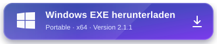

# Arena Studio Connecter

Eine Windows-Desktop-App, die **Arena Agent** sicher mit deinen aktuell geöffneten
**Roblox-Studio-Places** verbindet.

Die App startet die lokale HTTP/MCP-Bridge, installiert das Studio-Plugin automatisch,
erstellt einen temporären Cloudflare-HTTPS-Tunnel und erzeugt für jede offene Place einen
fertigen Arena-Prompt. Im Roblox-Plugin müssen **keine URL und kein Token** eingetragen werden.

## Download

<p align="center">
  <a href="https://raw.githubusercontent.com/alamerstudios/ArenaBridgeRoblox/v2.0.0/downloads/Arena-Studio-Connecter-Portable-2.0.0-x64.exe">
    
  </a>
  <br />
  <sub>Windows 10/11 · 64 Bit · portable · keine Installation erforderlich</sub>
</p>

<p align="center">
  <a href="https://raw.githubusercontent.com/alamerstudios/ArenaBridgeRoblox/v2.0.0/downloads/Arena-Studio-Connecter-Portable-2.0.0-x64.exe.sha256.txt">SHA-256-Prüfsumme</a>
  ·
  <a href="https://github.com/alamerstudios/ArenaBridgeRoblox/releases/tag/v2.0.0">Release-Details</a>
  ·
  <a href="#windows-exe-verwenden">Schnellstart</a>
</p>

## Highlights

- Dunkelblaue native Desktop-Oberfläche mit Animationen
- Alle aktuell verbundenen Studio-Places in einer Übersicht
- Aktiver Roblox-Studio-Account unten links
- Ein eigener **„Prompt kopieren“**-Button pro Place
- Temporärer Cloudflare Quick Tunnel ohne manuelle Konfiguration
- Session-Token ausschließlich im Prompt/Header, **nie in der Guide-URL**
- Lila **„Arena AI öffnen“**-Button für <https://arena.ai/agent>
- Automatische Plugin-Installation nach `%LOCALAPPDATA%\Roblox\Plugins`
- Plugin verbindet sich automatisch über einen separaten Loopback-Discovery-Port
- Mehrere offene Places werden über `targetClientId` sicher getrennt
- Optionaler Open-Cloud-API-Key, verschlüsselt mit Windows DPAPI gespeichert
- HTTP-API plus MCP-kompatibler JSON-RPC-Endpoint

---

## Windows-EXE verwenden

1. `Arena-Studio-Connecter-Portable-2.0.0-x64.exe` starten. Die portable App muss nicht installiert werden.
   Bei einem nicht signierten Entwicklungsbuild kann Windows SmartScreen einmalig nachfragen.
2. **Arena Studio Connecter** öffnet Bridge, Tunnel und Plugin automatisch. Beim ersten Start
   wird das SHA-256-verifizierte Cloudflared-Modul geladen; das kann je nach Verbindung kurz dauern.
3. Roblox Studio nach der ersten Installation einmal neu starten.
4. In Studio unter **Game Settings → Security → Allow HTTP Requests** aktivieren.
5. Eine Place öffnen. Sie erscheint nach wenigen Sekunden in der Desktop-App.
6. Bei der gewünschten Place auf **Prompt kopieren** klicken.
7. Unten links **Arena AI öffnen** wählen und den Prompt in einen neuen Agent-Chat einfügen.

Das Studio-Plugin zeigt nur den Verbindungsstatus. Es gibt dort bewusst keine Felder für URL,
Token oder API-Key.

### Was im kopierten Prompt steht

Der Prompt enthält:

- die temporäre `https://…trycloudflare.com`-Adresse,
- den nur für diesen App-Start gültigen Bridge-Token,
- die eindeutige Studio-Client-ID der gewählten Place,
- Place-/Universe-/Account-Metadaten,
- einen Link auf `/agent/guide?clientId=…`,
- klare Anweisungen zur Authentifizierung und sicheren Zielauswahl.

Der Token wird nicht an die URL gehängt. Arena Agent sendet ihn nur so:

```text
Authorization: Bearer <SESSION_TOKEN>
```

Die Guide-URL selbst ist geheimnisfrei. Schreibende API-Aufrufe bleiben ohne gültigen
Bearer-Token gesperrt.

---

## Automatisches Roblox-Plugin

Bei jedem App-Start wird aus
[`roblox/ArenaStudioConnecter.server.lua`](roblox/ArenaStudioConnecter.server.lua) ein lokales
`ArenaStudioConnecter.rbxmx` erzeugt und in den Roblox-Plugin-Ordner kopiert. Eine alte,
von dieser Repo stammende Vorgänger-Plugin-Datei wird entfernt; andere lokale Plugins werden
nicht verändert.

Das Plugin fragt die aktuelle lokale Bridge-Session über
`http://127.0.0.1:32192/v1/session` ab. Dieser Discovery-Port:

- bindet ausschließlich an `127.0.0.1`,
- wird **nicht** durch Cloudflare veröffentlicht,
- liefert den dynamischen Token nur an lokale Prozesse,
- speichert den Token nicht in Roblox Studio.

Danach meldet das Plugin Place-ID, Universe-ID, Place-Name und den Studio-Account an und
pollt gezielt nach Befehlen für diese Place.

---

## Open Cloud API Key

Der Key ist optional. Die Live-Verbindung zu einer geöffneten Studio-Place funktioniert
ohne Open Cloud.

Wenn ein Key für zusätzliche Publishing-Abläufe hinterlegt wird, sollte er in Roblox Creator
Dashboard minimal berechtigt sein:

1. Nur die wirklich benötigte Experience auswählen.
2. **Place Publishing → Write** nur aktivieren, wenn Open-Cloud-Publishing benötigt wird.
3. Keine Data-Store-, Messaging-, Memory-Store- oder Asset-Rechte vergeben, solange die
   jeweilige Aufgabe sie nicht ausdrücklich braucht.

Die Desktop-App speichert den Key über Windows DPAPI verschlüsselt. Er wird weder in Logs
noch in die Cloudflare-URL oder den kopierten Arena-Prompt geschrieben.

---

## Architektur

```text
┌──────────────────────── Arena Studio Connecter.exe ────────────────────────┐
│                                                                            │
│  Desktop UI ── Prompt/Status ── Local Bridge ── Cloudflare Quick Tunnel    │
│                                  127.0.0.1:<dynamisch>      │               │
│                                             ▲              │ HTTPS         │
│  Plugin Discovery 127.0.0.1:32192 ──────────┘              ▼               │
└────────────────────────────────────────────────────── Arena Agent ─────────┘
                         ▲
                         │ Long Poll + Bearer Token
                         │
                  Roblox Studio Plugin
                  (eine Client-ID pro Place)
```

Roblox Studio nimmt keine eingehenden Verbindungen an. Deshalb pollt das Plugin die lokale
Bridge. Arena Agent erreicht dieselbe Bridge über den temporären Tunnel. Befehle enthalten
eine `targetClientId`, damit bei mehreren Studio-Fenstern nie die falsche Place geändert wird.

---

## API für Arena Agent

| Methode | Pfad | Token | Zweck |
|---|---|:---:|---|
| GET | `/health` | – | Liveness-Check |
| GET | `/agent/guide?clientId=…` | – | Secret-freie Agent-Anleitung |
| GET | `/status` | ✓ | Bridge, Statistik und verbundene Places |
| GET | `/actions` | ✓ | Verfügbare Studio-Aktionen |
| POST | `/command` | ✓ | Befehl gezielt an eine Place senden |
| GET | `/command/:id` | ✓ | Asynchronen Befehl nachschlagen |
| GET | `/queue` | ✓ | Queue-Zustand |
| GET | `/logs` | ✓ | Bereinigte Bridge-Logs |
| POST | `/token/rotate` | ✓ | Session-Token sofort austauschen |
| GET/POST | `/mcp` | ✓ | MCP-kompatibles JSON-RPC 2.0 |
| POST | `/studio/handshake` | ✓ | Plugin-Anmeldung |
| GET | `/studio/poll` | ✓ | Plugin-Long-Poll |
| POST | `/studio/result` | ✓ | Plugin-Ergebnis |

Beispiel für eine gezielte Place:

```bash
curl -X POST "https://DEIN-TUNNEL.trycloudflare.com/command" \
  -H "Authorization: Bearer <SESSION_TOKEN>" \
  -H "Content-Type: application/json" \
  -d '{
    "action": "list_instances",
    "params": { "path": "game.Workspace", "depth": 2 },
    "targetClientId": "CLIENT_ID_AUS_DEM_PROMPT"
  }'
```

Vollständige Endpunkt- und Aktionsdetails stehen in [docs/API.md](docs/API.md).

---

## Sicherheit

- Bei jedem Start entsteht ein neuer kryptografischer Token mit 192 Bit Entropie.
- Session-Token liegen nur im RAM und in einer lokalen, gitignorierten Session-Datei.
- Logs maskieren bekannte Secrets.
- Der öffentliche Tunnel zeigt keine Desktop-Oberfläche und keine Discovery-Route.
- Alle Steuer-, MCP- und Studio-Endpunkte verlangen den Token.
- Der Guide enthält keinen Token.
- Nach 20 ungültigen Authentifizierungsversuchen wird der Client blockiert.
- Die Bridge begrenzt Requests und Request-Größen.
- Open-Cloud-Keys werden mit Windows DPAPI verschlüsselt.
- Das Electron-Fenster läuft mit `contextIsolation`, Sandbox und deaktivierter Node-Integration.
- Die portable Einzeldatei-App nutzt ein isoliertes natives WebView2-Fenster; dessen Control-API bindet nur an eine zufällige Loopback-Adresse und akzeptiert ausschließlich den eigenen Origin.

Der Session-Token erlaubt Codeausführung in der ausgewählten Studio-Place. Teile ihn nur mit
dem Arena-Agent-Chat, für den er erzeugt wurde. App-Neustart oder `POST /token/rotate` macht
den alten Token sofort ungültig.

---

## Entwicklung

Voraussetzung: Node.js 18+.

```bash
npm install
npm test                    # Unit- und End-to-End-Tests
npm start                   # Bridge ohne Desktop-Fenster
npm run desktop             # Electron-App im Entwicklungsmodus
npm run dist:standalone     # direkte Windows-x64-Einzeldatei-EXE
npm run dist:download       # geprüfte EXE nach downloads/ übernehmen
npm run dist:win            # alternativ: Electron Installer + portable EXE
```

`npm run dist:standalone` funktioniert auch auf Linux: Das Skript lädt die fest gepinnten
npm-Pakete für Bun 1.4.3 und das native Windows-WebView2-Modul, verifiziert die PE-Datei
per SHA-256 und cross-kompiliert anschließend eine direkt startbare EXE:

```text
release/Arena-Studio-Connecter-Portable-2.0.0-x64.exe
```

`npm run dist:download` übernimmt exakt diese Datei nach `downloads/` und erzeugt die
SHA-256-Prüfsumme für den README-Download. Es gibt keinen vorgeschalteten Selbstentpacker.
Cloudflared 2026.8.2 wird beim ersten App-Start aus der offiziellen Quelle oder dem gepinnten
npm-Fallback geladen und vor der Ausführung gegen den fest hinterlegten SHA-256-Wert geprüft.

Der alternative Electron-Build erzeugt zusätzlich
`Arena-Studio-Connecter-Setup-2.0.0-x64.exe`. Die temporären Build-Ausgaben unter `release/`
sind gitignoriert; die direkt startbare EXE unter `downloads/` wird versioniert.

### Projektstruktur

```text
desktop/
  main.js                 Electron-Hauptprozess und Service-Lifecycle
  preload.cjs             minimale, sichere Renderer-API
  cloudflareTunnel.js     Cloudflare-Prozess und URL-Erkennung
  discoveryServer.js      nur lokaler Plugin-Bootstrap
  pluginInstaller.js      automatische RBXMX-Installation
  settingsStore.js        DPAPI-verschlüsselte Einstellungen
  renderer/               dunkelblaue animierte Desktop-UI
standalone/
  main.js                 kompakter Bun-/WebView2-Host für die portable EXE
  windowsSettingsStore.js DPAPI- und Autostart-Integration ohne Electron
downloads/
  direkte Windows-EXE und Prüfsumme für den README-Download
src/
  server.js               HTTP-Server, Routing und Auth
  core/                   Token, Session, Queue, Prompt, Logging
  routes/                 REST, Studio, MCP und Agent Guide
roblox/
  ArenaStudioConnecter.server.lua
scripts/
  Build-Vorbereitung, Cloudflared-Download, CLI, Mock-Studio, PowerShell-Launcher
tests/
  Token-, Server-, Routing-, Prompt-, Discovery- und Installer-Tests
```

## Lizenz

MIT
